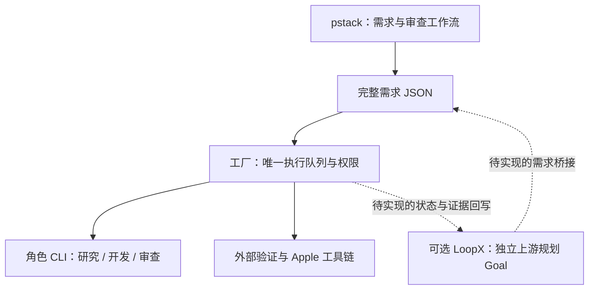

# Apple App Factory

Flutter 应用自主开发与 App Store Connect 交付调度器。任务和证据落在 SQLite，不依赖聊天窗口持续打开。代码与模型输出不能保证苹果批准，系统不生成审核专用功能、隐藏 A/B 面或用于规避审核的混淆代码。

## 启动

Node 要求见 [`package.json` 的 `engines`](package.json)。执行链以 TypeScript 编写并编译到 `dist/`；`src/schemas.ts` 的 Zod 契约校验配置、产品需求、模型判定和持久化任务。

```sh
npm ci
npm run build
node dist/cli.js init
```

`init` 不覆盖现有文件。先配置生成的 `factory.json`：

- 在专用、可信的开发账户或虚拟机中运行，再启用 `allowLocalExecution`。
- 设置已安装且已登录的 `builder`、`reviewer`；可选 `researcher` 单独负责调研，未设置时使用 reviewer 的配置。每个角色可选不同 CLI 或模型，研究和审查必须支持只读调用。先按 [Provider](#provider) 选择适配器、模型和认证方式。
- 安装 Flutter、完整 Xcode 和目标模拟器，把实际可执行程序放入 worker 的 `PATH`。`IOS_DEVICE_ID` 必须是运行目标的真实 ID；可用目标由 `flutter devices` 查询。
- 为沙箱开发设置可选的 `toolchain.flutterSdk`，指向已安装 SDK 的根目录，不是 `bin`，且不能位于 `workspaceRoot` 内。控制器先预热 SDK，在 macOS 上用系统写时复制创建任务内 `.factory-cache/flutter`，并把 Dart、Pub 和分析器缓存留在任务目录。外部核验与打包选用配置指定的 SDK 和独立的 `stateDir/verification-cache`，不以模型自己的 SDK 副本作为通过依据。SDK 路径、框架与引擎版本保存到任务状态；删除临时缓存不会取消版本固定，变更工具链必须重新建立有效证明。
- 验证命令归配置所有。`verification.prerequisites` 配置环境先决条件；`checks` 做静态、测试和构建检查，`runtime` 必须实际运行验收流程。命令使用 argv 数组而非 shell 字符串；`${NAME}` 从允许的环境中解析，不会交给 shell 展开。环境检查与代码缺陷分开处理，不因缺少 Xcode 而要求 agent 重写应用。

[`examples/luggage.json`](examples/luggage.json) 是行李配重应用的需求与验收契约，不是已经构建好的应用。发布前必须替换示例 Bundle ID 并补充真实发布资料。

在同一个 worker 账户中完成 CLI 登录、设置所需环境后，检查配置并提交一个完整需求：

```sh
node dist/cli.js doctor --build-only
node dist/cli.js submit examples/luggage.json --build-only
node dist/cli.js scan --observe --build-only
node dist/cli.js run --build-only
```

`doctor` 的 help 探测只检查可执行程序和声明的选项，不证明认证、模型额度或任务执行成功；初始配置的 `allowLocalExecution=false` 会明确报出未授权执行。没有完整 Xcode、Flutter 或实际模拟器时，原生 iOS 验收仍然阻塞，不能把模型输出或 Linux 上的检查当作替代。

`submit` 把完整需求 JSON 原子写入 `inbox.directory`，返回文件路径，不启动 worker；`run` 按 `inbox.pollMs` 持续巡查并领取任务，不向终端索取确认。在另一个终端用下方命令检查或停止。若只想触发一次，使用 `run --once --build-only`：先巡查一次，最多执行一个到期阶段，不保证完成整个应用。

也可从标准输入提交，或绕过收件箱直接入队；以下是同一需求的替代入口，不必重复运行：

```sh
cat examples/luggage.json | node dist/cli.js submit - --build-only
node dist/cli.js enqueue examples/luggage.json --build-only
```

配置和需求在入队时快照保存，之后编辑 `factory.json` 不会暗中改变在途任务。更换角色或模型后，先停止并重启持续 worker，让**后续入队任务**使用新配置；旧任务的显式迁移见 [验收与恢复](#验收与恢复)。

`maxConcurrentJobs` 限制同时执行的任务阶段数；同一任务不能重叠执行，研究、开发和独立审查可并发。共享 Apple 工具的验证与打包按队列互斥，旧命令组未清理时不会启动冲突阶段。每个需求使用独立工作目录和预算；一个任务阻塞或失败不会停止其他需求。配置契约和上限见 `src/schemas.ts` 的 `ConfigSchema`。

```sh
node dist/cli.js inbox --build-only
node dist/cli.js status --build-only
node dist/cli.js status <task-id> --build-only
node dist/cli.js events <task-id> --build-only
node dist/cli.js worker --build-only
node dist/cli.js stop --build-only
```

将 `<task-id>` 替换为 `inbox` 的 `jobId` 或 `status` 的 `id`。完整 `status <task-id>` 包含错误、阶段日志路径与已保存证据；按该路径查看日志以区分认证／模型不可用、工具链缺失和工程缺陷。模型调用的角色与路由记录在 `events`，不要公开含需求或模型输出的原始日志。

`scan --observe` 校验目录中的需求并预览冲突，不入队、不更新收件箱记录；`scan --build-only` 立即执行一次入队巡查。坏文件单独记录错误，不阻断其他文件。重复扫描、重启、改名和仅调整 JSON 格式不会重新执行相同产品版本；同版本内容冲突不会覆盖在途或已完成任务。`inbox` 查询各文件的持久接收结果，`status` 查询任务。巡查诊断写到 stderr，任务结果保持 stdout JSON。

`JobSchema.requestSpec` 保存原始接收需求，审核修复只递增执行规格 `spec` 的构建号，不改变收件箱身份。对已有需求修改记录但没有原始快照的旧任务，迁移保留 `requestSpec=null`，由 `requestSpecError` 说明原因；历史接收记录不被当作原始身份的证明，也不猜测旧构建号。此时仅可用真实原件执行 `reconcile-intake <task-id> <original-spec.json>` 恢复身份；该操作不重置预算、改写执行规格或授予发布权限，已知身份不能被覆盖。

已有产品的后续需求须提交新的 `apple.version`。要继续上一版代码，在完整需求 JSON 中增加 `baseJobId`，指向同产品已完成且有有效源码验证摘要的任务；控制器核对摘要后复制源码到新目录，不复用生成缓存、验证结论或发布权限，不修改上一版。未指定前序任务时从独立空目录开始。发布权限始终来自可信配置快照，需求文件不能授予。

`stop` 请求当前队列所有者停止接单，清理本次命令组和前序 worker 遗留且可验证归属的命令组，再保存续跑状态、释放锁；不按任意 PID 发送信号。SIGINT/SIGTERM 使用同一清理路径。归属不明或被其他进程组持有的输出管道无法确认清理时，会报错并保留 `manualRecovery`，不冒充干净停止。`worker` 报告持久所有者 PID 和停止请求，不把残留记录冒充健康检查。

`packageTarget` 选择最终本地产物：`simulator` 生成可供模拟器运行的 `.app`，不需要发布证书；`ipa` 使用 `apple.exportOptionsPlist` 和有效签名导出 IPA。两者都需要 Mac 上的完整 Xcode。`allowSubmit=false` 不再跳过打包：通过验证和审查后实际构建产物、保存摘要，停在 `built`，不访问 App Store Connect。模拟器构建不等于签名 IPA 或真机验收。
IPA 打包先读取并校验导出配置，只允许 `destination=export`，再创建临时配置快照供 Xcode 使用；缺省时也显式写入本地导出。`destination=upload` 会绕过提交模块直接上传，因此即使另有发布授权也禁止在打包阶段使用。临时快照在构建完成或中断后删除。

### Linux 控制端与 Mac mini

队列、工作目录、模型认证和构建工具链只在 Mac mini；Linux 不复制 SQLite，也不启动第二套相同任务。Linux 通过 OpenSSH 调用同一 Mac CLI。按 [`examples/remote.json`](examples/remote.json) 配置已验证的 SSH 别名、远端工程目录、Node 和配置文件的绝对路径，再运行：

```sh
node dist/cli.js remote doctor --config remote.json
node dist/cli.js remote submit examples/luggage.json --config remote.json
node dist/cli.js remote scan --observe --config remote.json
node dist/cli.js remote run --once --config remote.json
node dist/cli.js remote inbox --config remote.json
node dist/cli.js remote status --config remote.json
node dist/cli.js remote status <task-id> --config remote.json
node dist/cli.js remote events <task-id> --config remote.json
node dist/cli.js remote retry <task-id> --config remote.json
node dist/cli.js remote worker --config remote.json
node dist/cli.js remote stop --config remote.json
node dist/cli.js remote service --config remote.json
```

`submit` 从 Linux 读取并校验需求，通过标准输入写入 Mac 收件箱；`remote scan --observe`、`remote inbox`、`remote worker` 和 `remote stop` 用于巡查预览、接收状态和运行控制。不会同步代码、证书或模型凭据。`remote service` 仅输出 Mac 的 launchd 配置，不安装服务。持续 worker 由 Mac 服务持有；Linux 可定时执行单阶段命令。同一队列只允许一个调度进程，该进程按配置并发执行不同任务。远程命令固定启用 `--build-only`，拒绝带发布授权的配置或任务；不能远程授权上传。SSH 必须预先完成公钥登录与主机指纹验证；连接使用非交互认证及严格主机校验，不接受密码提示、不关闭校验、不转发认证代理。


## Provider

配置契约见 [`ProviderSchema`](src/schemas.ts)，实际命令见 [`providerCommand`](src/agents.ts)：

- `kind` 选择工厂适配器，只能是 `codex`、`cursor`、`pi`、`deepseek`，不是模型厂商名。
- `executable` 是已安装 CLI 的程序名或路径；默认依次为 `codex`、`agent`、`pi`、`dsh`。它不是安装命令，也不能填带参数的 shell 字符串。
- `provider` 是适配器内部的路由：Pi 的 provider ID 或 Codex 已配置的 `model_provider`；两者命名空间不通用。Cursor 不接受此字段，DeepSeek Harness 的路由在 headless profile 中设置。
- `model` 是该路由和账户实际可用的模型 ID。Pi 设置 `provider` 时必须同时设置 `model`；DeepSeek Harness 不接受工厂的 `model` 字段。

### 安装与认证

只安装所选路线需要的 CLI，并在运行 worker 的同一 OS 账户中完成认证。以下命令按需执行；审阅上游安装脚本后再运行：

| 适配器 | 安装 | 认证与选择模型 |
| --- | --- | --- |
| Codex | `npm install -g @openai/codex` | `codex login`；API key 路线用 `printenv OPENAI_API_KEY \| codex login --with-api-key`，`codex login status` 查看认证方式。见 [安装](https://developers.openai.com/codex/cli/)与[认证](https://developers.openai.com/codex/auth/)。 |
| Cursor | `curl https://cursor.com/install -fsS \| bash` | `agent login`、`agent status`；无人值守也可使用 `CURSOR_API_KEY`。用 `agent --list-models` 查询可选模型。见 [安装](https://cursor.com/docs/cli/installation)、[认证](https://cursor.com/docs/cli/reference/authentication)、[参数](https://cursor.com/docs/cli/reference/parameters)。 |
| Pi | `npm install -g --ignore-scripts @earendil-works/pi-coding-agent` | 启动 `pi`，用 `/login` 选择该 provider 支持的认证方式，`/model` 选模型；或使用下表 API key 环境变量。`pi --list-models` 查询安装版本的模型路由。见 [安装](https://github.com/earendil-works/pi/blob/main/packages/coding-agent/README.md#getting-started)、[认证](https://github.com/earendil-works/pi/blob/main/packages/coding-agent/docs/providers.md)、[模型](https://github.com/earendil-works/pi/blob/main/packages/coding-agent/docs/models.md)。 |
| DeepSeek Harness | `npm install -g @deepseek-ai/dsh` | 按 [headless 文档](https://github.com/deepseek-ai/deepseek-harness/blob/master/packages/bundle/headless/README.md#credentials)与[默认模型配置](https://github.com/deepseek-ai/deepseek-harness/blob/master/packages/core/agent-default-model/README.md#configure-the-default)配置 headless profile。其默认关闭托管凭据存储，不能假设 GUI 登录会传入 headless；API key 可来自 launch 环境。见 [官方入口](https://github.com/deepseek-ai/deepseek-harness#run)。 |

Pi 必须兼容工厂使用的 [`CLI` 选项](https://github.com/earendil-works/pi/blob/main/packages/coding-agent/docs/cli.md)，包括 `--print`、`--no-session`、`--no-extensions`、`--no-mcp`、`--no-skills`、`--no-prompt-templates`、`--no-themes`、`--no-approve` 和 `--tools`。不要把另一个名为 `pi` 的程序或缺少这些选项的发行版当成兼容实现，也不要删掉隔离选项来绕过 `doctor`。扩展式 provider 在此适配器下不可用，因为扩展被禁用。

### 主要厂商路线

下面是工厂已实现的适配器路线，不是已认证供应商清单。Pi provider ID 与变量对应关系由上游 [`env-api-keys.ts` 的 `getApiKeyEnvVars`](https://github.com/earendil-works/pi/blob/main/packages/ai/src/env-api-keys.ts)和[认证文档](https://github.com/earendil-works/pi/blob/main/packages/coding-agent/docs/providers.md)定义；模型 ID 以 CLI 和账户实际可用列表为准，不在这里复制模型目录。

| 模型厂商 | 工厂角色配置 | 环境认证路线 |
| --- | --- | --- |
| OpenAI / Codex | `kind: "codex"`；或 `kind: "pi", provider: "openai", model: "…"` | Codex 登录缓存或 API key；Pi 的 OpenAI API key 为 `OPENAI_API_KEY`。订阅和 API 计费权限不可互换。 |
| Anthropic / Claude | `kind: "pi", provider: "anthropic", model: "…"` | `ANTHROPIC_API_KEY`；Pi 的 `/login` 还可提供该 provider 支持的其他方式。不是原生 `claude` CLI 适配器。 |
| Google / Gemini | `kind: "pi", provider: "google", model: "…"` | `GEMINI_API_KEY`。不是 `kind: "gemini"`，也不是原生 Gemini CLI 适配器。 |
| xAI / Grok | `kind: "pi", provider: "xai", model: "…"` | `XAI_API_KEY`。不要混淆 xAI 的 `xai` 与 Groq 的 `groq`。 |
| DeepSeek | `kind: "pi", provider: "deepseek", model: "…"`；或 `kind: "deepseek"` | Pi 使用 `DEEPSEEK_API_KEY`；DSH 使用其 headless profile 配置的 provider 认证。厂商与 harness 不是同一个配置字段。 |
| Cursor 提供的模型 | `kind: "cursor", model: "…"`，仅 builder | Cursor 账户或 `CURSOR_API_KEY`；选其模型 ID，不传 Pi provider 或厂商 API key 来替代 Cursor 登录。 |

`builder` 可写代码；`researcher` 负责调研，省略时继承 reviewer；`reviewer` 独立审查。研究与审查要求非编辑调用：Codex 使用 read-only 沙箱，Pi 仅开放 `read,grep,find,ls` 并禁用扩展／MCP，DSH 使用 read-only permission preset。Cursor Ask 模式不是文件系统只读隔离，因此只能用作 builder，不能用作 researcher 或 reviewer。Pi builder 以宿主账户权限执行，不提供 OS 沙箱；DSH 的权限／沙箱后端须在真实任务中确认。

将下面字段合并到 `init` 生成的 `factory.json`，保留其他队列、验证与权限配置。所有 `replace-with-…` 都必须换成对应 CLI 和账户可用的真实模型 ID；示例不是可以直接调用的模型名称：

```json
{
  "researcher": { "kind": "pi", "provider": "google", "model": "replace-with-google-model-id", "executable": "pi" },
  "builder": { "kind": "codex", "model": "replace-with-codex-model-id", "executable": "codex" },
  "reviewer": { "kind": "pi", "provider": "anthropic", "model": "replace-with-anthropic-model-id", "executable": "pi" },
  "agentEnv": ["OPENAI_API_KEY", "GEMINI_API_KEY", "ANTHROPIC_API_KEY", "IOS_DEVICE_ID"]
}
```

`agentEnv` 只保存允许继承的**变量名**，不保存密钥值，也不会自动加载 `.env`。把实际值放在 worker 的受保护环境或供应商私有登录存储中；保留运行验收所需的 `IOS_DEVICE_ID`。切换到 Grok、DeepSeek 或 Cursor API key 路线时，相应加入 `XAI_API_KEY`、`DEEPSEEK_API_KEY` 或 `CURSOR_API_KEY`，删除不再需要的名字。该允许列表由所有角色共享，并非按角色隔离；不需要的密钥不要传入。不要提交 API key、认证缓存、私钥或含密钥的配置；以登录存储认证时仍须保证 worker 账户及其 HOME／凭据存储可访问。发布凭据前缀不能加入 `agentEnv`，但环境过滤也不能阻止同账户读取文件，边界见 [Apple 发布](#apple-发布)。

Codex 使用 `exec`、明确沙箱策略和最终响应文件；控制器显式向其工具 shell 传递 CI／SDK／缓存环境，不通过这条通道传递模型或 Apple 凭据。Provider 的能力探测也使用环境允许列表，不继承发布凭据或未允许变量。非空最终响应与退出码 0 都不能代替 JSON 判定、外部验证或独立审查。先运行 `doctor`，再提交真实需求并检查任务日志，才能判断该账户的路线是否可用；本说明不声称所有供应商已登录或完成实测。

### pstack、LoopX 与执行所有权

本工程的已实现连接是上述 coding CLI 适配器，以及 [SSH 控制入口](#linux-控制端与-mac-mini)。[pstack](https://github.com/cursor/plugins/blob/main/pstack/README.md) 是工程工作流，不是模型 API；[LoopX](https://github.com/loopx-project/loopx/blob/main/README.md) 保存长期目标、决策与证据，不提供本工程的 Apple 发布权限。两者都不是新的 `kind`。

组合使用时，让工厂独占应用执行队列、任务快照、重试预算、验证和发布授权；pstack 用于需求澄清与工程审查方法，不另开一个针对相同任务的执行循环。按 pstack 官方步骤，Cursor 可用 `/add-plugin pstack` 安装，再执行 `/setup-pstack` 和 `/poteto-mode`；Claude Code 的安装与命令前缀见其 [harness 说明](https://github.com/cursor/plugins/blob/main/pstack/docs/harness/claude-code.md)。这些是操作员在相应宿主中的可选操作，工厂不会自动安装或调用 slash 命令；Pi 路线也不会自动加载 pstack 技能。



图中的 LoopX 桥接是**建议设计，仓库未实现**：LoopX 只拥有独立的上游规划／需求 Goal，保存工厂任务引用和状态投影，不认领相同执行阶段，也不镜像维护第二套阶段 Todo、门禁、配额或证据权威。桥接将已接受需求送入 `submit`，扫描入队后从 `inbox` 获取 `jobId`，再以 `status`、`events` 的实际结果回写引用；不要把“需求已接收”写成“构建成功”。开发前先读上游[最小自定义 runtime](https://github.com/loopx-project/loopx/blob/main/docs/guides/minimal-custom-runtime-example.md)、[runner 集成](https://github.com/loopx-project/loopx/blob/main/docs/guides/custom-agent-runner-integration.md)和[worker bridge 契约](https://github.com/loopx-project/loopx/blob/main/docs/integrations/worker-bridge-install-contract.md)：上游动作读取新准入与所有权，实际验证后持久回写和记账，并按契约应用调度提示。若要让 LoopX 原生控制应用执行，必须通过未来的 typed adapter **替换或明确委托**工厂控制循环，并限定到目标任务的有界作用，不能嵌套两套控制器。本工程没有该 adapter、LoopX 事件订阅器或可直接运行的桥接命令。

持续执行由 Mac worker 与操作系统服务负责，见 [持续运行](#持续运行)。pstack 模式、LoopX 技能或会话内 `/loop` 都不能保证宿主退出、机器休眠或断电后继续运行。

## 验收与恢复

阶段依次为研究、开发、外部验证、独立只读审查和本地打包；只有另行授权上传才会继续提交和状态监测。每个产品使用独立目录。研究下载 Apple 官方规则，保存抓取时间与内容摘要；这是模型的风险评估，不是苹果预审结论。调研必须覆盖 `src/runner.ts` 的 `REQUIRED_POLICY_RULES`，包括商业模板／生成服务与内容提供者提交主体的 4.2.6；未知主体不能由模型编造或代为确认。产品用途与目标用户完全相同的换名任务会被拒绝；其他实质差异由研究和审查判断，不设代码混淆或代码相似度过审指标。

验证执行固定命令；审查必须覆盖每条验收。源码指纹在验证、审查、打包和提交之间校验，运行截图另存指纹，本地产物独立校验摘要。只有 `src/dependencies.ts` 的 `GENERATED_PATHS` 所列工作目录相对路径作为生成物排除；同名的嵌套源码目录仍被校验。可达本地 path 依赖必须位于非生成的工作目录源码中，且使用相对路径以支持后续需求复制；外部共享目录和缓存中的可变包不能借主工程摘要获得放行。验证同时检查声明、覆盖及解析元数据；合法的工作目录内本地包会随源码一起校验和复制。生成的包解析表另由同文件的 `dependencyDigest` 记录有效根路径、包路径和语言配置；忽略生成时间，不忽略 hosted／SDK／git 包的解析重定向。验证前后及审查、打包、提交边界都核对该快照，后续需求不继承它。输出路径在目标尚不存在时也检查已有祖先，避免软链把构建写到目录外。
调研、开发、独立审查分别执行，不能让 builder 自己降低验收。失败原因和近期执行日志进入下一轮修复提示，`events <task-id>` 保留状态变化用于复盘；不会把一次模型建议自动升级为产品决策或全局规范。这沿用 [Magpie 的证据与经验约束](https://github.com/yetone/magpie/blob/main/LESSONS.md)，不复制其社区机器人或账号治理。外部需求、网页和社区消息不是提升权限或关闭验证的授权。

- `built`：实际本地产物已构建并保存摘要，未上传，不代表苹果批准。完整 `status <task-id>` 的 `artifact` 给出类型、路径与摘要。
- `approved`：苹果版本审核状态已批准，不等于商店可下载。
- `released`：配置市场的公开查询同时匹配该 Bundle ID 和版本。
- `blocked`：环境先决条件或发布前置条件未满足，或远端操作结果不能安全判断；不会伪造成功。只有明确的环境先决条件阻塞允许自动复查。
- `failed`：当前阶段重试、agent 调用次数或开发时限耗尽。

预算字段及默认值由 `src/schemas.ts` 的 `ConfigSchema` 定义。`maxAgentCalls` 计算实际 CLI 启动次数，不是供应商内部请求次数或美元预算。原生 agent 可能自行重试。开发时限控制研究至打包阶段的新启动，单条命令另有超时；发布对账和审核等待不占开发时限。单机队列只允许一个调度进程，并发上限控制其在途任务；已记录命令组通过所有权标记和持久截止时间恢复，无法确认归属时明确停止，绝不在旧命令旁并发重放。

`verification.prerequisites` 和受管 SDK 准备的明确失败会记录 `blockedReason.kind=prerequisite`，按配置的轮询间隔自动复查；环境恢复后继续执行，不需要 `retry`，也不消耗工程重试和模型调用预算，但仍受开发时限约束。权限错误、检查超时、未知提交结果和发布授权不会因此自动放行。无法确认的进程归属通过 `manualRecovery` 保留；即使其他自有进程已清理，仍需显式恢复，不能静默重放。
工作目录和 SDK 准备成功前不计工程尝试次数；准备期间的权限、超时或路径隔离异常保留当前阶段和预算，安全阻塞，不转交模型重写，也不中断其他任务。

需要更改执行配置时，仅对 `blocked`、`ready` 或 `built` 任务执行 `node dist/cli.js retry <task-id> --build-only`，重新快照并续跑，保留预算和该任务原有的发布权限；它不能重置 `failed` 的耗尽预算，也不能修改正在运行的任务。验证策略、reviewer 或 SDK 配置变化，以及旧任务缺少依赖解析快照，都会要求重新验证；已经开始的发布不能靠改配置绕过旧收据。此操作也是对进程人工恢复标记的显式确认，需要先核对记录的进程状态。需要单独授予发布权限时，在任何远端意图产生前使用 `authorize <task-id> --submit [--release]`；最初入队已授权的任务不需要这一步。`feedback <task-id> <file>` 仅接受已观测到拒审的任务，读取真实审核意见、递增构建号并开始新的修复预算，同时保留原有发布权限。输入须为非软链的普通文件，大小上限由 `src/requirements.ts` 的 `MAX_INPUT_BYTES` 定义；文件在进入队列写事务前读取，管道不会占住队列。本工程没有读取 Resolution Center 完整消息的连接器；拒审后不能在缺少真实意见时自动猜测和重提。暂时的审核状态查询故障会退避重查，不重新上传或提交。

`retry`、`authorize` 和 `feedback` 在同一 SQLite 事务中读取当前状态、校验前置条件并保存变更；任务已被 worker 领取时，不会用旧的停止状态覆盖在途任务。已有上传或远端意图的发布恢复，对传输故障、HTTP 408／429／5xx 按轮询间隔继续等待，不因工程重试次数耗尽而丢失恢复入口；非暂时错误保持阻塞，收据和原有预算保留。

## Apple 发布

默认不上传、不提交、不公开发布。发布权限由入队快照中的 `allowSubmit` 控制；`allowRelease` 是单独的自动公开发布权限。仅启用前者时请求人工发布选项；同时启用后者时请求 `AFTER_APPROVAL`，并继续检查配置市场的公开版本。

发布账户必须预先完成开发者注册、App/Bundle 记录、协议、分类和本地化、隐私披露、年龄分级、内容权利、出口合规、价格和地区可用性以及适用的法律声明。`manualSetupConfirmed: true` 是发布者的事实确认，不能由模型代签，也不是系统自动核验了这些声明。

发布前，在需求的 `apple` 中填写 `src/apple.ts` 的 `validateAppleSpec` 所要求的真实字段：应用与版本标识、商店说明、关键词、公开 HTTPS 支持与隐私 URL、审核备注、版权与审核联系人。更新版本还需按 Apple 要求提供 `whatsNew`。自动公开发布还需 `storefrontCountry` 两字母市场代码。

配置 `apple.exportOptionsPlist` 指向发布主机上真实的导出配置；签名证书、描述文件和项目签名设置必须有效。仅发布进程环境使用：

- `ASC_KEY_ID`
- `ASC_ISSUER_ID`
- `ASC_PRIVATE_KEY_PATH`

使用具有所需权限的团队 API key。`doctor` 在启用发布时执行只读认证与上传工具探测，不上传文件。实际流程使用当前 Xcode 的 `xcrun altool`、ES256 JWT 和 App Store Connect REST API，保存每次写入意图与收据。遇到不确定上传/创建/提交结果先对账，无法确定时停止，绝不盲目重传。

上传意图 `intent` 本身不能证明远端同版本构建来自本地 IPA；旧 `reconciled` 状态也不能补出成功交付证据。只有成功交付收据或既有的精确构建绑定能用于续跑，无法确认时停止并核对 Apple 交付记录，不自动采用碰巧同号的构建、不重复上传。已绑定的远端构建不能静默替换。

本地截图使用 `apple.screenshotsDir`，相对任务工作目录，布局为 `<screenshotDisplayType>/*.png|jpg|jpeg`，每组需符合 Apple 的设备与尺寸要求。只接受真实运行截图。当前实现使用 Apple 仍公开描述但已弃用的 screenshot/set API，不支持 Asset Library-only 素材；接口不可用会报错，不会假装上传成功。

**凭据环境过滤不是操作系统隔离。** Pi builder、插件/MCP、应用依赖或构建脚本可能拥有宿主账户权限；同一账户可读的 `.p8` 不会因环境变量被删除而变得不可读。不要把开发 agent 和发布私钥放在可相互访问的账户或挂载中。本调度器不提供跨账户/远端发布 worker 或恶意代码隔离；使用前需由宿主隔离方案满足该边界，不能把工作目录当沙箱。

## 持续运行

```sh
node dist/cli.js service --build-only
```

此命令只输出 launchd plist，不安装或启动后台服务。输出配置使用 `RunAtLoad` 启动，并在异常退出后重启；正常的 `stop`、SIGINT/SIGTERM 退出不会被立即拉起。由受控的开发主机安装所输出的配置，确保 worker 的 PATH、模拟器和所需环境变量在 launchd 环境中有效。终端里的 `export` 不保证传给 launchd。机器休眠、重启、供应商配额和 Apple 服务中断仍会影响连续性；需要常开的 macOS 主机，不能把一次运行当作 24 小时运行证明。

这里不依赖会话内 `/loop` 保活。[Claude Code 官方调度说明](https://code.claude.com/docs/en/scheduled-tasks) 定义了会话存活、忙时调度、过期与恢复限制；需要持续构建时使用 Mac 服务和持久队列，不能以循环提示词代替它们。

## 检查

```sh
npm test
```

测试覆盖需求巡查与原子接收、并发与共享工具互斥、队列及进程边界、中断恢复、前序版本源码隔离和 Apple 协议判断，其中 Apple 响应由测试控制；不构成真实上传、审核、iOS 真机或沙箱安全证明。动态证据看 `inbox`、`worker` 及 `status <task-id>` 返回的阶段、日志、策略摘要、源码摘要和发布收据。

## 官方规则与接口

- [App Review Guidelines](https://developer.apple.com/app-store/review/guidelines/)：尤其是 2.1、2.3.1、2.5.19、4.2/4.2.6、4.3、5.1.1。
- [Codex noninteractive](https://developers.openai.com/codex/noninteractive)、[Cursor CLI](https://cursor.com/docs/cli/reference/parameters)、[Pi CLI](https://github.com/earendil-works/pi/blob/main/packages/coding-agent/docs/cli.md)、[DeepSeek headless](https://github.com/deepseek-ai/deepseek-harness/blob/master/packages/bundle/headless/README.md)。
- [App Store Connect API](https://developer.apple.com/app-store-connect/api/)、[上传构建](https://developer.apple.com/help/app-store-connect/manage-builds/upload-builds)、[素材上传与迁移提示](https://developer.apple.com/documentation/appstoreconnectapi/uploading-assets-to-app-store-connect)、[发布选项](https://developer.apple.com/help/app-store-connect/manage-your-apps-availability/select-an-app-store-version-release-option/)。
